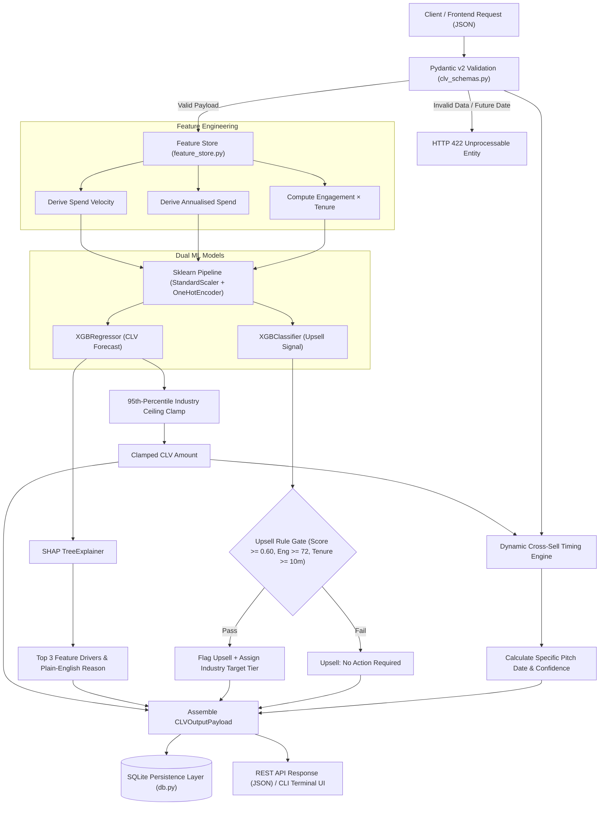

# Client Lifetime Value (CLV) Prediction Engine v2

A production-grade Machine Learning microservice that forecasts long-term enterprise account monetary value, detects high-probability upsell opportunities, dynamically schedules optimal cross-sell pitch dates, and delivers Explainable AI (XAI) insights via SHAP.

---

## 📑 Table of Contents

1. [Model Overview](#1-model-overview)
2. [Workflow & Architecture](#2-workflow--architecture)
3. [Input Parameters](#3-input-parameters)
4. [Output Parameters](#4-output-parameters)
5. [Technical Implementation & Algorithms](#5-technical-implementation--algorithms)
6. [API & Integration Details](#6-api--integration-details)
7. [Dependencies & Setup](#7-dependencies--setup)
8. [Error Handling & Validation](#8-error-handling--validation)
9. [Testing & Quality Assurance](#9-testing--quality-assurance)
10. [Limitations & Future Improvements](#10-limitations--future-improvements)

---

## 1. Model Overview

### 1.1 Purpose & Objectives
The **Client Lifetime Value (CLV) Prediction Engine** (Detagenix Module 8) is an enterprise B2B machine learning service designed to help sales leaders, account executives, and revenue operations teams prioritize accounts based on projected lifetime revenue. 

Unlike simple linear multipliers or rule-based heuristics, this engine couples gradient-boosted tree models with statistical guardrails and explainability techniques:
- **Quantitative Lifetime Value**: Forecasts total lifetime monetary spend in INR per account.
- **Upsell Intelligence**: Identifies when an account is primed for an upgrade tier using an ML classifier.
- **Dynamic Cross-Sell Timing**: Determines a personalized, calendar-specific pitch window rather than a static 30-day offset.
- **Explainable AI (XAI)**: Generates human-readable, transparent rationale for every forecast using SHAP (SHapley Additive exPlanations).

> [!NOTE]
> **Traditional ML Design**: No Large Language Models (LLMs) or generative AI APIs are used in this engine. All predictions and explanations are generated deterministically by gradient-boosted trees and game-theoretic attribution.

### 1.2 Target Use Cases
- **Account Prioritization**: Sales teams prioritize renewals and outreach for high-CLV accounts.
- **Timing Optimization**: Pinpoints the exact calendar date when a client is most receptive to add-on solutions.
- **Churn Prevention & Guardrails**: Flags accounts with declining engagement or plateauing spend velocity.
- **10 B2B Industry Verticals Supported**:
  - Technology
  - Finance
  - Healthcare
  - Retail
  - Manufacturing
  - Logistics & Supply Chain
  - Education
  - Real Estate
  - Hospitality
  - E-commerce

---

## 2. Workflow & Architecture

The microservice follows a decoupled pipeline from request validation to feature derivation, dual-model inference, guardrail clamping, explainability extraction, and database persistence.

### 2.1 End-to-End Processing Steps
1. **Request Intake**: Client payload arrives via REST API (`POST /api/v1/clv/predict`) or Terminal CLI.
2. **Schema & Contract Validation**: Pydantic v2 enforces boundary checks, enum compliance, and ISO-8601 calendar validity.
3. **Feature Engineering**: The feature store derives interaction terms (`spend_velocity`, `spend_per_tenure_year`, `engagement_x_tenure`).
4. **Data Preprocessing**: `ColumnTransformer` standardizes numerical features (`StandardScaler`) and one-hot encodes industry categories (`OneHotEncoder`).
5. **Dual-Model Inference**:
   - **XGBRegressor** computes raw lifetime revenue.
   - **XGBClassifier** calculates upsell probability.
6. **Guardrail Clamping**: Predicted CLV is capped against the pre-calculated 95th-percentile industry ceiling to prevent unrealistic runaway forecasts.
7. **Explainability Extraction**: `shap.TreeExplainer` calculates signed contributions for each feature and extracts the top 3 drivers.
8. **Dynamic Cross-Sell Scheduling**: Multi-factor timing heuristics combine client tenure, annual contract renewal cycle, engagement, and purchase frequency into an exact target pitch date.
9. **Persistence**: Input and output payloads, metadata, and SHAP drivers are stored in the local SQLite audit database (`database/clv_predictions.db`).
10. **Client Delivery**: Results are returned as structured JSON to API consumers or rendered into rich formatted terminal cards for account managers.

### 2.2 System Flowchart



---

## 3. Input Parameters

Predictions require **7 account parameters**. The schema is strictly validated by Pydantic v2 in [`app/clv_schemas.py`](file:///d:/client_lifetime_value_prediction_1/ai-ml-microservice/app/clv_schemas.py).

| Field Name | Type | Constraints & Rules | Sample Value | Description |
| :--- | :--- | :--- | :--- | :--- |
| `company_id` | `string` | Non-empty string or UUID | `"client-tech-001"` | Unique identifier of the enterprise client account. |
| `historical_spend_amount` | `float` | `>= 0.0` (INR) | `25000.0` | Total cumulative spend recorded to date in Indian Rupees. |
| `purchase_frequency_yearly` | `integer`| `>= 0` | `8` | Number of purchase/order cycles completed per calendar year. |
| `industry_type` | `string` | Must be 1 of 10 supported Enum values | `"Technology"` | B2B vertical category (determines ceilings & product catalogs). |
| `rolling_engagement_score` | `float` | `0.0` to `100.0` | `85.0` | Normalized account activity score based on platform usage & interactions. |
| `contract_tenure_months` | `integer`| `>= 0` | `24` | Cumulative months the client has been under active contract. |
| `contract_start_date` | `string` | Optional, ISO-8601 (`YYYY-MM-DD`), cannot be future | `"2024-01-15"` | Start date of initial contract. Used for annual renewal proximity adjustments. |

### 3.1 Supported Industry Enums
`Technology`, `Finance`, `Healthcare`, `Retail`, `Manufacturing`, `Logistics & Supply Chain`, `Education`, `Real Estate`, `Hospitality`, `E-commerce`.

### 3.2 Sample Input Payload (`POST /api/v1/clv/predict`)
```json
{
  "company_id": "client-tech-001",
  "historical_spend_amount": 25000.0,
  "purchase_frequency_yearly": 8,
  "industry_type": "Technology",
  "rolling_engagement_score": 85.0,
  "contract_tenure_months": 24,
  "contract_start_date": "2024-01-15"
}
```

---

## 4. Output Parameters

The engine returns a structured JSON payload divided into 3 major sections: **Core CLV Forecast**, **Expansion Analytics**, and **Cross-Sell Window**.

### 4.1 Schema Breakdown
- **`company_id`** (`string`): The client identifier provided in the request.
- **`predicted_clv_amount`** (`float`): Projected total monetary value in INR over the client's lifecycle.
- **`confidence_interval_percentage`** (`float`, 0–100%): Model confidence level calibrated by test R² and penalized for statistical outliers.
- **`prediction_timestamp`** (`string`): ISO-8601 UTC timestamp of inference generation.
- **`expansion_analytics`** (`object`):
  - `upsell_opportunity_detected` (`boolean`): Whether account qualifies for an upgrade.
  - `upsell_confidence_score` (`float`, 0.0–1.0): Probability generated by `XGBClassifier`.
  - `recommended_target_product` (`string`): Recommended upgrade tier for this industry.
  - `top_prediction_driver_reason` (`string`): Plain-English explanation of primary driver.
  - `shap_drivers` (`array`): Top 3 feature contributors containing `feature`, `value`, `shap_contribution`, `direction` (`positive`/`negative`), and `contribution_pct`.
- **`cross_sell_opportunity_window`** (`object`):
  - `cross_sell_detected` (`boolean`): Whether client qualifies for an add-on product.
  - `secondary_product_slug` (`string`): Machine-readable identifier for add-on module.
  - `secondary_product_name` (`string`): Human-readable product name.
  - `optimal_pitch_target_date` (`string`): Client-specific calendar pitch date (`YYYY-MM-DD`).
  - `days_until_optimal_pitch` (`integer`): Remaining days from current date to target pitch date.
  - `timing_confidence_score` (`float`, 0.0–1.0): Composite multi-factor timing confidence.
  - `pitch_rationale` (`string`): Contextual explanation for the selected target date.

### 4.2 Sample Output Response
```json
{
  "company_id": "client-tech-001",
  "predicted_clv_amount": 423671.66,
  "confidence_interval_percentage": 76.45,
  "expansion_analytics": {
    "upsell_opportunity_detected": false,
    "upsell_confidence_score": 0.2574,
    "recommended_target_product": "Enterprise AI Suite — Unlimited Seats + Custom Model Training",
    "top_prediction_driver_reason": "Historical spend of ₹25,000 is positively influencing the CLV forecast (22% of signal), reflecting the client's demonstrated spending capacity.",
    "shap_drivers": [
      {
        "feature": "Historical Spend",
        "value": 25000.0,
        "shap_contribution": 56410.05,
        "direction": "positive",
        "contribution_pct": 22.3
      },
      {
        "feature": "Industry Type",
        "value": "Technology",
        "shap_contribution": 50035.75,
        "direction": "positive",
        "contribution_pct": 19.8
      },
      {
        "feature": "Annualised Spend per Year",
        "value": 12500.0,
        "shap_contribution": 41412.02,
        "direction": "positive",
        "contribution_pct": 16.4
      }
    ]
  },
  "cross_sell_opportunity_window": {
    "cross_sell_detected": true,
    "secondary_product_slug": "ai-workflow-automation",
    "secondary_product_name": "AI Workflow Automation Module",
    "optimal_pitch_target_date": "2026-11-09",
    "days_until_optimal_pitch": 25,
    "timing_confidence_score": 0.825,
    "pitch_rationale": "Pitch timing adjusted for this client: high engagement (85/100) suggests client is receptive; frequent buyer (8/yr) accelerates timing."
  },
  "prediction_timestamp": "2026-10-15T10:00:32Z"
}
```

---

## 5. Technical Implementation & Algorithms

### 5.1 Machine Learning Models
- **Regression Engine (`XGBRegressor`)**: 
  - Fitted inside a scikit-learn `Pipeline` with `StandardScaler` and `OneHotEncoder`.
  - Hyperparameters: `n_estimators=180`, `max_depth=4`, `learning_rate=0.06`, `subsample=0.85`, `colsample_bytree=0.85`, `reg_alpha=0.1`, `reg_lambda=1.0`.
  - Objective: `reg:squarederror`. Evaluated on held-out test data achieving $R^2 \ge 0.76$.
- **Classification Engine (`XGBClassifier`)**:
  - Secondary model predicting binary upsell readiness (`0` or `1`).
  - Output probability represents `upsell_confidence_score`.

### 5.2 Feature Engineering Formulas ([`pipelines/feature_store.py`](file:///d:/client_lifetime_value_prediction_1/ai-ml-microservice/pipelines/feature_store.py))
To prevent train/serve skew, both training and production inference import feature logic from `feature_store.py`:
$$\text{Spend Velocity} = \frac{\text{historical\_spend\_amount}}{\max(\text{contract\_tenure\_months}, 1)}$$

$$\text{Spend per Tenure Year} = \frac{\text{historical\_spend\_amount}}{\max\left(\frac{\text{contract\_tenure\_months}}{12}, 0.25\right)}$$

$$\text{Engagement} \times \text{Tenure} = \text{rolling\_engagement\_score} \times \text{contract\_tenure\_months}$$

### 5.3 Ceiling Clamp (Guardrail Formula)
To prevent extreme extrapolation on outlier accounts, every prediction is passed through a per-industry ceiling:
$$\text{Ceiling} = \text{historical\_spend\_amount} \times \text{Multiplier}_{95\text{th}}$$
$$\text{CLV}_{\text{final}} = \min(\text{CLV}_{\text{raw}}, \text{Ceiling})$$

Industry 95th-percentile multipliers are calculated during training and stored in `models_registry/industry_clv_ceilings.json`.

### 5.4 Dynamic Cross-Sell Pitch Algorithm
Rather than assigning a fixed 30-day follow-up, pitch dates are computed through behavioral adjustments:
$$\text{Total Offset} = \max\left(7, \text{Base Offset}(45) + \text{Adj}_{\text{eng}} + \text{Adj}_{\text{freq}} + \text{Adj}_{\text{tenure}} + \text{Adj}_{\text{renewal}}\right)$$

| Factor | Condition | Adjustment |
| :--- | :--- | :--- |
| **Engagement** | $\ge 80$ / $\ge 65$ / $\ge 50$ / $\ge 35$ / $<35$ | $-15$ d / $-8$ d / $0$ d / $+10$ d / $+20$ d |
| **Purchase Frequency** | $\ge 10$ / $\ge 6$ / $\ge 3$ / $<3$ per year | $-10$ d / $-5$ d / $0$ d / $+8$ d |
| **Contract Tenure** | $<6$ months / $<12$ months / $\ge 12$ months | $+15$ d / $+5$ d / $0$ d |
| **Renewal Proximity** | Contract annual cycle in month 10–11.5 | $-10$ d (Pitch before annual budget lock) |

### 5.5 Multi-Factor Timing Confidence
$$\text{Confidence} = 0.50 \times \left(\frac{\text{Engagement}}{100}\right) + 0.30 \times \min\left(\frac{\text{Freq}}{12}, 1.0\right) + 0.20 \times \mathbb{I}_{(\text{CLV} > \text{Industry Median})}$$

---

## 6. API & Integration Details

### 6.1 Comprehensive API Endpoints Reference

The service exposes 6 REST API endpoints. Below is a detailed breakdown of **where**, **when**, and **how** each endpoint is used, along with exact request/response schemas.

---

#### 1. `POST /api/v1/clv/predict` — Single Account Prediction
* **Where & When it is used**: 
  * Triggered whenever an account executive or sales representative views an individual client's profile in the CRM or Frontend dashboard.
  * Used on-demand to recalculate revenue projections when a client signs a contract extension or completes a major purchase.
* **How it is used**:
  * Send an HTTP `POST` request with a JSON payload satisfying the `CLVInputPayload` schema.
* **cURL Request Example**:
  ```bash
  curl -X POST "http://127.0.0.1:8000/api/v1/clv/predict" \
    -H "Content-Type: application/json" \
    -d '{
      "company_id": "client-tech-001",
      "historical_spend_amount": 25000.0,
      "purchase_frequency_yearly": 8,
      "industry_type": "Technology",
      "rolling_engagement_score": 85.0,
      "contract_tenure_months": 24,
      "contract_start_date": "2024-01-15"
    }'
  ```
* **Response Body (`200 OK`)**:
  ```json
  {
    "company_id": "client-tech-001",
    "predicted_clv_amount": 423671.66,
    "confidence_interval_percentage": 76.45,
    "expansion_analytics": {
      "upsell_opportunity_detected": false,
      "upsell_confidence_score": 0.2574,
      "recommended_target_product": "Enterprise AI Suite — Unlimited Seats + Custom Model Training",
      "top_prediction_driver_reason": "Historical spend of ₹25,000 is positively influencing the CLV forecast (22% of signal), reflecting the client's demonstrated spending capacity.",
      "shap_drivers": [
        {
          "feature": "Historical Spend",
          "value": 25000.0,
          "shap_contribution": 56410.05,
          "direction": "positive",
          "contribution_pct": 22.3
        },
        {
          "feature": "Industry Type",
          "value": "Technology",
          "shap_contribution": 50035.75,
          "direction": "positive",
          "contribution_pct": 19.8
        },
        {
          "feature": "Annualised Spend per Year",
          "value": 12500.0,
          "shap_contribution": 41412.02,
          "direction": "positive",
          "contribution_pct": 16.4
        }
      ]
    },
    "cross_sell_opportunity_window": {
      "cross_sell_detected": true,
      "secondary_product_slug": "ai-workflow-automation",
      "secondary_product_name": "AI Workflow Automation Module",
      "optimal_pitch_target_date": "2026-11-09",
      "days_until_optimal_pitch": 25,
      "timing_confidence_score": 0.825,
      "pitch_rationale": "Pitch timing adjusted for this client: high engagement (85/100) suggests client is receptive; frequent buyer (8/yr) accelerates timing."
    },
    "prediction_timestamp": "2026-10-15T10:00:32Z"
  }
  ```

---

#### 2. `POST /api/v1/clv/batch-predict` — Batch Prediction & Data Drift Detection
* **Where & When it is used**:
  * Used in **nightly or weekly automated cron jobs** (e.g., Sunday night ETL pipeline) to recalculate CLV for hundreds or thousands of accounts simultaneously.
  * Used when importing client datasets from external CSV or ERP sources.
  * Inbuilt drift detection logs warnings if the average batch engagement deviates by $>15\%$ from baseline.
* **How it is used**:
  * Send an HTTP `POST` containing a JSON array of client objects (`list[CLVInputPayload]`).
  * Individual record errors are caught and logged without aborting the entire batch run.
* **cURL Request Example**:
  ```bash
  curl -X POST "http://127.0.0.1:8000/api/v1/clv/batch-predict" \
    -H "Content-Type: application/json" \
    -d '[
      {
        "company_id": "client-001",
        "historical_spend_amount": 15000.0,
        "purchase_frequency_yearly": 4,
        "industry_type": "Retail",
        "rolling_engagement_score": 68.0,
        "contract_tenure_months": 12
      },
      {
        "company_id": "client-002",
        "historical_spend_amount": 45000.0,
        "purchase_frequency_yearly": 10,
        "industry_type": "Finance",
        "rolling_engagement_score": 92.0,
        "contract_tenure_months": 36,
        "contract_start_date": "2023-08-01"
      }
    ]'
  ```
* **Response Body (`200 OK`)**:
  ```json
  [
    {
      "company_id": "client-001",
      "predicted_clv_amount": 164210.50,
      "confidence_interval_percentage": 76.5,
      "expansion_analytics": { ... },
      "cross_sell_opportunity_window": { ... },
      "prediction_timestamp": "2026-10-15T10:05:00Z"
    },
    {
      "company_id": "client-002",
      "predicted_clv_amount": 589400.00,
      "confidence_interval_percentage": 82.0,
      "expansion_analytics": { ... },
      "cross_sell_opportunity_window": { ... },
      "prediction_timestamp": "2026-10-15T10:05:01Z"
    }
  ]
  ```

---

#### 3. `GET /api/v1/clv/history/{company_id}` — Client Prediction Audit Trail
* **Where & When it is used**:
  * Used in the **Account History / Audit Timeline** tab of the frontend CRM.
  * Allows account executives to see how a client's CLV forecast, upsell signals, and engagement have trended across multiple quarters.
* **How it is used**:
  * Send an HTTP `GET` with the `company_id` passed in the URL path.
* **cURL Request Example**:
  ```bash
  curl -X GET "http://127.0.0.1:8000/api/v1/clv/history/client-tech-001"
  ```
* **Response Body (`200 OK`)**:
  ```json
  [
    {
      "id": 34,
      "prediction_timestamp": "2026-10-15T10:00:32Z",
      "company_id": "client-tech-001",
      "industry_type": "Technology",
      "historical_spend_amount": 25000.0,
      "purchase_frequency_yearly": 8,
      "rolling_engagement_score": 85.0,
      "contract_tenure_months": 24,
      "predicted_clv_amount": 423671.66,
      "confidence_interval_pct": 76.45,
      "upsell_opportunity_detected": 0,
      "upsell_confidence_score": 0.2574,
      "recommended_target_product": "Enterprise AI Suite — Unlimited Seats + Custom Model Training",
      "cross_sell_detected": 1,
      "secondary_product_name": "AI Workflow Automation Module",
      "optimal_pitch_target_date": "2026-11-09",
      "days_until_optimal_pitch": 25,
      "timing_confidence_score": 0.825,
      "top_prediction_driver_reason": "Historical spend of ₹25,000 is positively influencing the CLV forecast..."
    }
  ]
  ```
* **Error Response (`404 Not Found`)**: If no predictions exist for the requested client ID:
  ```json
  { "detail": "No predictions found for company_id: unknown-client" }
  ```

---

#### 4. `GET /api/v1/clv/summary` — Executive Leadership Dashboard Stats
* **Where & When it is used**:
  * Used in the **Main Executive KPI Widget** on leadership dashboards.
  * Gives VP of Sales and RevOps leadership immediate visibility into portfolio revenue potential and upsell readiness.
* **How it is used**:
  * Send an HTTP `GET` request. No query parameters or body required.
* **cURL Request Example**:
  ```bash
  curl -X GET "http://127.0.0.1:8000/api/v1/clv/summary"
  ```
* **Response Body (`200 OK`)**:
  ```json
  {
    "total_predictions": 36,
    "avg_predicted_clv": 407427.0,
    "upsell_rate_pct": 18.2,
    "cross_sell_rate_pct": 60.6,
    "avg_confidence_pct": 70.7
  }
  ```

---

#### 5. `GET /api/v1/clv/recent` — Recent Accounts Activity Feed
* **Where & When it is used**:
  * Used in the **Live Activity Table** or "Recently Processed Accounts" widget on the frontend dashboard.
  * Allows team members to quickly jump to recently predicted clients.
* **How it is used**:
  * Send an HTTP `GET` request with an optional `limit` query parameter (default: 10, min: 1, max: 100).
* **cURL Request Example**:
  ```bash
  curl -X GET "http://127.0.0.1:8000/api/v1/clv/recent?limit=5"
  ```
* **Response Body (`200 OK`)**:
  ```json
  [
    {
      "company_id": "909",
      "industry_type": "Technology",
      "predicted_clv_amount": 231329.59,
      "upsell_opportunity_detected": 0,
      "optimal_pitch_target_date": "2026-11-21",
      "prediction_timestamp": "2026-10-15T10:56:37Z"
    },
    {
      "company_id": "client-tech-001",
      "industry_type": "Technology",
      "predicted_clv_amount": 423671.66,
      "upsell_opportunity_detected": 0,
      "optimal_pitch_target_date": "2026-11-09",
      "prediction_timestamp": "2026-10-15T10:00:32Z"
    }
  ]
  ```

---

#### 6. `GET /health` — Service Liveness Probe
* **Where & When it is used**:
  * Used by **Docker, Kubernetes (Liveness/Readiness Probes), AWS ALB, or NGINX** to ensure the microservice is operational before routing incoming web traffic.
  * Used by `clv_cli.py status` to confirm connectivity before executing interactive CLI commands.
* **How it is used**:
  * Send an HTTP `GET` request to `/health`.
* **cURL Request Example**:
  ```bash
  curl -X GET "http://127.0.0.1:8000/health"
  ```
* **Response Body (`200 OK`)**:
  ```json
  {
    "status": "ok",
    "service": "CLV Prediction Engine",
    "version": "2.0.0"
  }
  ```

### 6.2 Architecture Integration: Frontend (MongoDB) & ML Microservice (SQLite)

In standard production microservices architecture, the **Database-per-Service** pattern is followed:
- **Frontend / Main Backend**: Can use MongoDB (or PostgreSQL/MySQL) to store users, client profiles, authentication, and core application state.
- **AI/ML Microservice**: Uses local SQLite (`database/clv_predictions.db`) strictly for **internal audit logging and prediction tracking**.
- **No Shared Database Needed**: The frontend never connects directly to SQLite. Communication is completely decoupled over HTTP/JSON.

```text
[ Frontend / Main App (Any PC) ]
            │
            │  1. Pulls client info from MongoDB
            │  2. Sends JSON request via HTTP POST
            ▼
[ AI/ML Microservice (FastAPI on Port 8000) ]
            │
            │  3. Runs XGBoost + SHAP + Dynamic Timing
            │  4. Saves audit record to SQLite (internal)
            │  5. Returns structured JSON output
            ▼
[ Frontend / Main App (Any PC) ]
            │
            │  6. Saves CLV result into MongoDB & displays in UI
```

### 6.3 Cross-PC Network & CORS Configuration
To allow a frontend on another computer on the local network (LAN) to connect:
1. **Host Binding**: Start Uvicorn listening on `0.0.0.0`:
   ```bash
   uvicorn main:app --host 0.0.0.0 --port 8000 --reload
   ```
2. **CORS Policy**: Configured in [`main.py`](file:///d:/client_lifetime_value_prediction_1/ai-ml-microservice/main.py#L42-L49) with `CORSMiddleware` (`allow_origins=["*"]`) to prevent browser cross-origin blocks.
3. **Endpoint URL**: The frontend should replace `localhost` with the ML host machine's LAN IP:
   ```javascript
   // Replace with actual IP of the machine running the ML microservice
   const ML_API_URL = "http://192.168.1.10:8000/api/v1/clv/predict";
   ```

### 6.4 Integration Code Examples

#### JavaScript / TypeScript (Frontend Integration)
```javascript
async function fetchAccountCLV(clientData) {
  try {
    const response = await fetch("http://192.168.1.10:8000/api/v1/clv/predict", {
      method: "POST",
      headers: { "Content-Type": "application/json" },
      body: JSON.stringify({
        company_id: clientData._id.toString(),
        historical_spend_amount: clientData.totalSpend,
        purchase_frequency_yearly: clientData.annualOrders,
        industry_type: clientData.industry,
        rolling_engagement_score: clientData.engagementScore,
        contract_tenure_months: clientData.tenureMonths,
        contract_start_date: clientData.contractStartDate // "YYYY-MM-DD"
      }),
    });

    if (!response.ok) {
      const errorData = await response.json();
      throw new Error(`CLV API Error: ${JSON.stringify(errorData)}`);
    }

    const clvResult = await response.json();
    console.log("Predicted CLV:", clvResult.predicted_clv_amount);
    return clvResult;
  } catch (error) {
    console.error("Failed to fetch CLV prediction:", error);
  }
}
```

#### Python Backend Integration
```python
import requests

payload = {
    "company_id": "client-009",
    "historical_spend_amount": 35000.0,
    "purchase_frequency_yearly": 6,
    "industry_type": "Finance",
    "rolling_engagement_score": 82.0,
    "contract_tenure_months": 20,
    "contract_start_date": "2024-03-01"
}

response = requests.post("http://127.0.0.1:8000/api/v1/clv/predict", json=payload)
data = response.json()
print(f"CLV: ₹{data['predicted_clv_amount']:,.2f}")
print(f"Upsell: {data['expansion_analytics']['recommended_target_product']}")
```

---

## 7. Dependencies & Setup

### 7.1 Requirements & Prerequisites
- **Python**: Version `3.10` or higher (`3.12` recommended)
- **Dependencies** (from `requirements.txt`):
  - `fastapi>=0.111.0`
  - `uvicorn[standard]>=0.29.0`
  - `pydantic>=2.7.0`
  - `pandas>=2.2.0`
  - `numpy>=1.26.0`
  - `scikit-learn>=1.4.0`
  - `xgboost>=2.0.0`
  - `shap>=0.45.0`
  - `joblib>=1.4.0`
  - `rich>=13.0.0`
  - `httpx>=0.27.0`
  - `pytest>=8.2.0`

### 7.2 Environment Configuration ([`app/config.py`](file:///d:/client_lifetime_value_prediction_1/ai-ml-microservice/app/config.py))
Configurable via system environment variables without code modification:

| Variable | Default | Purpose |
| :--- | :--- | :--- |
| `CLV_DB_PATH` | `database/clv_predictions.db` | Local SQLite database file path. |
| `CLV_UPSELL_ENGAGEMENT_THRESHOLD` | `72.0` | Minimum engagement score required to trigger upsell. |
| `CLV_UPSELL_TENURE_MONTHS_THRESHOLD` | `10` | Minimum tenure in months required for upsell. |
| `CLV_UPSELL_ML_SCORE_THRESHOLD` | `0.60` | Minimum classifier probability floor for upsell. |
| `CLV_CROSS_SELL_MIN_PURCHASE_FREQUENCY`| `3` | Minimum yearly purchase frequency for cross-sell. |
| `CLV_CROSS_SELL_BASE_OFFSET_DAYS` | `45` | Base window days before behavioral adjustments. |
| `CLV_CLAMP_FALLBACK_MULTIPLIER` | `9.0` | Fallback ceiling multiplier if industry profile missing. |

### 7.3 Step-by-Step Installation & Run Instructions

#### 1. Clone & Set Up Virtual Environment
```bash
cd "d:\client_lifetime_value_prediction_1\ai-ml-microservice"
python -m venv venv
# Windows:
venv\Scripts\activate
# Linux/Mac:
source venv/bin/activate

pip install -r requirements.txt
```

#### 2. Start the FastAPI Server
```bash
python -m uvicorn main:app --host 0.0.0.0 --port 8000 --reload
```
Interactive API docs will be available at:
- **Swagger UI**: [http://127.0.0.1:8000/docs](http://127.0.0.1:8000/docs)
- **ReDoc**: [http://127.0.0.1:8000/redoc](http://127.0.0.1:8000/redoc)

#### 3. Run the Production Terminal CLI
Open a separate terminal window:
```bash
# Interactive Single Prediction
python clv_cli.py predict

# Output raw JSON
python clv_cli.py predict --json

# View Executive KPI Dashboard
python clv_cli.py dashboard

# View historical record of an account
python clv_cli.py history client-tech-001

# Run Visual Presentation Demo
python demo_terminal.py
```

#### 4. (Optional) Retrain Model Artifacts
Trained `.pkl` artifacts are pre-built in `models_registry/`. To regenerate synthetic data and retrain:
```bash
python generate_dataset.py
python train_clv_model.py
```

---

## 8. Error Handling & Validation

The microservice includes defensive validation at the network, schema, and model levels:

| HTTP Code | Error Condition | Root Cause & Resolution |
| :--- | :--- | :--- |
| **`422 Unprocessable Entity`** | Invalid date format / Future date | `contract_start_date` must match `YYYY-MM-DD` and cannot be in the future. |
| **`422 Unprocessable Entity`** | Invalid `industry_type` | Must match one of the 10 defined B2B enum strings exactly. |
| **`422 Unprocessable Entity`** | Negative spend / tenure | `historical_spend_amount`, `contract_tenure_months`, and `purchase_frequency_yearly` must be $\ge 0$. |
| **`503 Service Unavailable`** | Missing model artifacts | `models_registry/*.pkl` missing. Run `python train_clv_model.py` to compile. |
| **`500 Internal Server Error`** | Unhandled prediction exception | Check server logs for stack trace; invalid mathematical values (e.g. NaN) are logged. |

### CLI Visual Alert Boxes
When invalid inputs are entered interactively into `clv_cli.py`, the CLI traps the error and displays a structured error panel prompting for re-entry:
```text
┌────────────────────────── Date Validation Failed ───────────────────────────┐
│ ❌ Invalid Date Format                                                      │
│                                                                             │
│ You entered: 2024-15-40                                                     │
│ Expected format: YYYY-MM-DD (e.g. 2024-01-15).                              │
│ Please enter a valid calendar date or press Enter to skip.                  │
└─────────────────────────────────────────────────────────────────────────────┘
```

---

## 9. Testing & Quality Assurance

The project contains automated unit and integration tests under [`tests/`](file:///d:/client_lifetime_value_prediction_1/ai-ml-microservice/tests/) verifying mathematical consistency, schema integrity, and boundary conditions.

### 9.1 Running the Test Suite
```bash
python -m pytest tests/ -v
```

### 9.2 Test Coverage Highlights
- **Mathematical Correctness (`test_clv_math.py`)**:
  - Validates `predicted_clv_amount` is always positive and finite.
  - Confirms SHAP driver output integrity (top 3, correct signed direction).
  - Verifies cross-sell pitch dates are valid future dates.
  - Validates date parsing and raises validation errors on future or malformed dates.
  - Tests prediction generation across all 10 industry verticals without exceptions.
- **Outlier & Guardrail Tests (`test_clv_outliers.py`)**:
  - **Zero Spend**: Ensures zero historical spend outputs ₹0 CLV without division-by-zero errors.
  - **Zero Tenure**: Verifies accounts active for 0 months are handled gracefully.
  - **Extreme Ceilings**: Validates 95th-percentile clamps hold even on multi-crore inputs.
  - **Engagement Boundaries**: Tests 0.0 and 100.0 engagement score extremes.

---

## 10. Limitations & Future Improvements

### 10.1 Known Limitations
1. **Catalog Mapping**: Upsell tiers and cross-sell modules are mapped to static industry platform catalogs defined in `config.py`.
2. **SQLite Concurrency**: The default SQLite database is suitable for single-instance microservice deployments. Under high concurrent write loads across multiple worker threads, write contention may occur.
3. **Synthetic Training Baseline**: The default pre-trained model is calibrated against realistic synthetic distributions. For enterprise deployment, it should be retrained on 12–24 months of historical ERP/CRM transaction records.

### 10.2 Future Improvements
- [ ] **External RDBMS Integration**: Add configuration adapters for PostgreSQL or MongoDB for enterprise cloud audit stores.
- [ ] **Real-time Event Streaming**: Ingest live webhook activity (e.g., from Segment or Mixpanel) to dynamically recalculate rolling engagement scores.
- [ ] **Automated Feedback Loop**: Log actual customer renewal outcomes to automatically trigger model drift alerts and automated retraining pipelines.
- [ ] **Multi-Currency Support**: Expand INR calculations to multi-currency conversions (USD, EUR, GBP) using real-time forex rates.
