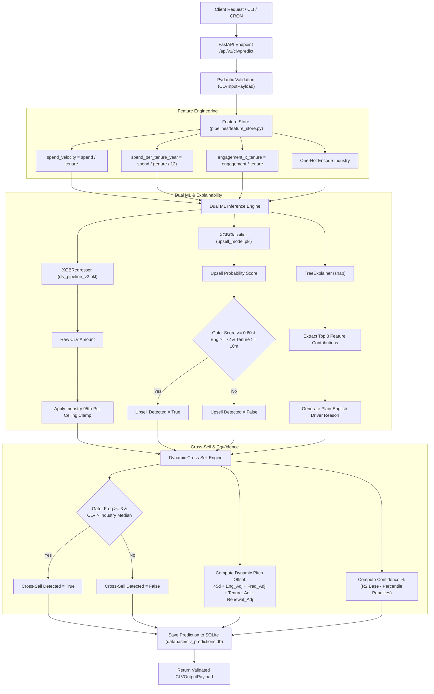

# Client Lifetime Value (CLV) Prediction Engine v2

A production-ready machine learning microservice that predicts the long-term monetary value (CLV in INR) of enterprise B2B accounts, detects binary upsell expansion signals using machine learning, and calculates dynamic, personalized cross-sell pitch windows with Explainable AI (SHAP).

---

## ⚡ Quick Start: Installation & How to Run

Get the microservice and terminal interface running locally in under 2 minutes:

### 1. Prerequisites
* **Python 3.10+** (tested on Python 3.12)
* Terminal: PowerShell (Windows) or Bash/Zsh (Linux/macOS)

### 2. Navigate & Set Up Virtual Environment
Open your terminal and navigate to the microservice directory:

```bash
cd "d:/client_lifetime_value_prediction_1/ai-ml-microservice"
```

Create and activate a virtual environment:
```powershell
# Windows (PowerShell):
python -m venv venv
.\venv\Scripts\activate

# Linux / macOS:
python3 -m venv venv
source venv/bin/activate
```

### 3. Install Dependencies
```bash
pip install -r requirements.txt
```

### 4. Start the API Server
All pre-trained model artifacts are already included in `models_registry/`. Launch the FastAPI server:

```bash
uvicorn main:app --reload --host 127.0.0.1 --port 8000
```

* **Interactive Swagger UI**: [`http://127.0.0.1:8000/docs`](http://127.0.0.1:8000/docs)
* **Interactive ReDoc UI**: [`http://127.0.0.1:8000/redoc`](http://127.0.0.1:8000/redoc)
* **Liveness Probe**: [`http://127.0.0.1:8000/health`](http://127.0.0.1:8000/health)

### 5. Interact via Production CLI
Open a **second terminal** (keep the API server running in the first), activate the virtual environment, and run:

```bash
# Check API connection status:
python clv_cli.py status

# Run an interactive single-account prediction prompt:
python clv_cli.py predict

# View the executive portfolio dashboard:
python clv_cli.py dashboard

# View audit history for an account:
python clv_cli.py history client-tech-001
```

### 6. Run the Visual Presentation Demo
To see the engine evaluate 6 diverse enterprise client scenarios across Technology, Finance, Healthcare, Retail, and Logistics:

```bash
python demo_terminal.py
```

### 7. Run the Full Test Suite
Verify that all 37 mathematical constraints, edge cases, and business guardrails pass:

```bash
python -m pytest tests/ -v
```

---

## 📑 Table of Contents

1. [Quick Start: Installation & How to Run](#-quick-start-installation--how-to-run)
2. [Model Overview](#1-model-overview)
3. [Workflow](#2-workflow)
4. [Input Parameters](#3-input-parameters)
5. [Output Parameters](#4-output-parameters)
6. [Technical Implementation](#5-technical-implementation)
7. [API & Integration Details](#6-api--integration-details)
8. [Configuration & Environment Variables](#7-configuration--environment-variables)
9. [Error Handling](#8-error-handling)
10. [Testing](#9-testing)
11. [Limitations & Future Improvements](#10-limitations--future-improvements)

---

## 1. Model Overview

### Purpose & Objectives
The **Client Lifetime Value (CLV) Prediction Engine v2** (Module 8 of the Detagenix Platform) provides predictive intelligence for enterprise B2B account retention and expansion. The engine solves three core operational challenges:
1. **Quantitative Revenue Forecasting**: Estimates the total future monetary value of an account over its active lifecycle in Indian Rupees (INR).
2. **Expansion Targeting (Upsell)**: Determines whether an account is ready for higher-tier upgrades using a trained machine learning classifier combined with engagement and tenure sanity gates.
3. **Dynamic Cross-Sell Scheduling**: Identifies high-value accounts eligible for complementary product modules and dynamically schedules an optimal pitch date based on account health, purchase cadence, and contract renewal timing.

### Core Philosophy
* **Zero Large Language Model (LLM) Dependency**: Pure classical and ensemble machine learning (`XGBoost`, `scikit-learn`, `SHAP`). Deterministic, reproducible, fast (sub-50ms inference), and free from generative hallucinations.
* **Explainable AI (XAI) First**: Every prediction provides the top 3 driving features with percentage contribution and plain-English reasoning via SHAP values.
* **Strict Guardrails**: Enforces per-industry 95th-percentile growth ceilings and zero-spend bounds to ensure predictions remain realistic.

### Supported Industries
The engine natively supports 10 B2B industry verticals, each calibrated with distinct spending distributions, growth multipliers, and product catalogs:
* Technology
* Finance
* Healthcare
* Retail
* Manufacturing
* Logistics & Supply Chain
* Education
* Real Estate
* Hospitality
* E-commerce

### Business Use Cases
* **Key Account Planning**: Equips Account Executives and Customer Success Managers with prioritized expansion candidates during Quarterly Business Reviews (QBRs).
* **Automated CRM Action Triggers**: Automatically updates CRM fields (e.g., Salesforce, HubSpot) with predicted CLV and schedules calendar reminders for the dynamic cross-sell pitch window.
* **Churn Mitigation**: Highlights deteriorating accounts where negative SHAP drivers (e.g., declining engagement or spend velocity) threaten future account value.
* **Executive Revenue Pipeline Forecasting**: Aggregates account lifetime value across portfolio cohorts for leadership dashboards.

---

## 2. Workflow

The end-to-end inference workflow runs deterministically from input validation through feature derivation, dual-model scoring, business clamping, explainability generation, and persistence.

### Step-by-Step Execution Flow
1. **Request Validation**: The client submits an account payload via HTTP or CLI. Pydantic validates data types, non-negative constraints, and industry enums.
2. **Feature Engineering**: The feature store derives interaction and velocity metrics (`spend_velocity`, `spend_per_tenure_year`, `engagement_x_tenure`) to ensure train/serve parity.
3. **CLV Regression**: The feature vector is passed to the preprocessed `XGBRegressor` pipeline to compute the raw predicted CLV.
4. **Per-Industry Ceiling Clamp**: The raw CLV prediction is capped at the empirical 95th percentile ceiling for the client's industry to prevent runaway outlier predictions.
5. **SHAP Driver Extraction**: A pre-cached `shap.TreeExplainer` decomposes the prediction into feature contributions, maps one-hot encoded categories back to human-readable names, and extracts the top 3 drivers.
6. **ML Upsell Classification**: An `XGBClassifier` scores the client's upgrade propensity. The opportunity is flagged `true` only if the ML probability exceeds `0.60` AND the client passes engagement ($\ge 72$) and tenure ($\ge 10\text{ months}$) guardrails.
7. **Dynamic Cross-Sell Engine**: Evaluates whether the client's CLV exceeds the industry median and purchase frequency $\ge 3$. Computes a personalized pitch target date by dynamically adjusting a base 45-day window against engagement, frequency, tenure, and annual contract renewal proximity.
8. **Confidence Interval Estimation**: Starts from the baseline model $R^2$ score and deducts graduated penalties for any feature values falling outside the empirical 1st–99th training percentiles.
9. **Persistence & Response**: The full prediction record, including SHAP drivers JSON, is logged to SQLite (`clv_predictions.db`) for auditing, and the validated `CLVOutputPayload` is returned.

### Architecture Flowchart



---

## 3. Input Parameters

Predictions are initiated by posting a JSON payload conforming to the `CLVInputPayload` schema.

### Parameter Specification

| Parameter Name | Data Type | Format / Constraints | Required | Sample Value | Description & Business Rules |
| :--- | :--- | :--- | :---: | :--- | :--- |
| `company_id` | `string` | Non-empty string | Yes | `"client-tech-001"` | Unique identifier for the enterprise account or lead. |
| `historical_spend_amount` | `float` | $\ge 0.0$ | Yes | `22000.0` | Total cumulative spend in INR across all completed invoices. If `0.0`, CLV is clamped to `0.0`. |
| `purchase_frequency_yearly`| `integer` | $\ge 0$ | Yes | `8` | Number of distinct orders or renewal transactions per calendar year. |
| `industry_type` | `string` | Valid `IndustryType` Enum | Yes | `"Technology"` | B2B vertical. Must match one of the 10 supported industry strings exactly. |
| `rolling_engagement_score` | `float` | $0.0 \le x \le 100.0$ | Yes | `88.5` | Composite engagement metric reflecting portal usage, support interactions, and feature adoption. |
| `contract_tenure_months` | `integer` | $\ge 0$ | Yes | `28` | Number of continuous active months under contract. |
| `contract_start_date` | `string` | ISO-8601 `YYYY-MM-DD` | No | `"2024-06-15"` | Effective agreement start date. Used to detect approaching annual contract renewals. |

### Supported `industry_type` Enum Values
* `"Technology"`
* `"Finance"`
* `"Healthcare"`
* `"Retail"`
* `"Manufacturing"`
* `"Logistics & Supply Chain"`
* `"Education"`
* `"Real Estate"`
* `"Hospitality"`
* `"E-commerce"`

### Sample Input Payload
```json
{
  "company_id": "client-tech-001",
  "historical_spend_amount": 22000.0,
  "purchase_frequency_yearly": 8,
  "industry_type": "Technology",
  "rolling_engagement_score": 88.5,
  "contract_tenure_months": 28,
  "contract_start_date": "2024-06-15"
}
```

---

## 4. Output Parameters

The engine returns a structured, fully validated `CLVOutputPayload`.

### Output Field Specification

| JSON Key | Type | Description |
| :--- | :--- | :--- |
| `company_id` | `string` | The client identifier from the input request. |
| `predicted_clv_amount` | `float` | Estimated remaining/total lifetime value in INR, bounded by industry guardrails. |
| `confidence_interval_percentage` | `float` | Estimated statistical reliability ($5.0\% - 100.0\%$) based on training $R^2$ and input distribution overlap. |
| `expansion_analytics` | `object` | Upsell signal, product recommendations, and explainability breakdown. |
| `expansion_analytics.upsell_opportunity_detected` | `boolean` | `true` if client passes both ML upsell confidence and business sanity gates. |
| `expansion_analytics.upsell_confidence_score` | `float` | Raw probability output from the `XGBClassifier` ($0.0 - 1.0$). |
| `expansion_analytics.recommended_target_product` | `string` | Industry-specific premium upgrade tier recommendation. |
| `expansion_analytics.top_prediction_driver_reason` | `string` | Plain-English summary explaining the #1 primary factor influencing the forecast. |
| `expansion_analytics.shap_drivers` | `array[object]` | Top 3 features by absolute SHAP impact with signed values and relative percentage attribution. |
| `cross_sell_opportunity_window` | `object` | Complementary product recommendation and dynamic scheduling metrics. |
| `cross_sell_opportunity_window.cross_sell_detected` | `boolean` | `true` if purchase frequency $\ge 3$ and predicted CLV exceeds the industry median. |
| `cross_sell_opportunity_window.secondary_product_slug` | `string` | Machine-readable slug for the recommended cross-sell add-on. |
| `cross_sell_opportunity_window.secondary_product_name` | `string` | Human-readable title for the cross-sell module. |
| `cross_sell_opportunity_window.optimal_pitch_target_date` | `string` | Personalized pitch target date formatted as `YYYY-MM-DD`. |
| `cross_sell_opportunity_window.days_until_optimal_pitch` | `integer` | Number of calendar days from today until the optimal pitch date. |
| `cross_sell_opportunity_window.timing_confidence_score` | `float` | Multi-factor confidence score for pitch timing ($0.0 - 1.0$). |
| `cross_sell_opportunity_window.pitch_rationale` | `string` | Narrative explanation of how client behavior shifted the pitch timing. |
| `prediction_timestamp` | `string` | UTC timestamp in ISO-8601 format (`YYYY-MM-DDTHH:MM:SSZ`). |

### Sample Output Response
```json
{
  "company_id": "client-tech-001",
  "predicted_clv_amount": 412850.50,
  "confidence_interval_percentage": 76.45,
  "expansion_analytics": {
    "upsell_opportunity_detected": true,
    "upsell_confidence_score": 0.8421,
    "recommended_target_product": "Enterprise AI Suite — Unlimited Seats + Custom Model Training",
    "top_prediction_driver_reason": "Engagement score of 89/100 is positively driving the CLV prediction, accounting for 38% of the model's signal — high engagement signals strong retention.",
    "shap_drivers": [
      {
        "feature": "Engagement Score",
        "value": 88.5,
        "shap_contribution": 48210.35,
        "direction": "positive",
        "contribution_pct": 38.2
      },
      {
        "feature": "Engagement × Tenure Interaction",
        "value": 2478.0,
        "shap_contribution": 39150.12,
        "direction": "positive",
        "contribution_pct": 31.0
      },
      {
        "feature": "Historical Spend",
        "value": 22000.0,
        "shap_contribution": 38920.45,
        "direction": "positive",
        "contribution_pct": 30.8
      }
    ]
  },
  "cross_sell_opportunity_window": {
    "cross_sell_detected": true,
    "secondary_product_slug": "ai-workflow-automation",
    "secondary_product_name": "AI Workflow Automation Module",
    "optimal_pitch_target_date": "2026-11-10",
    "days_until_optimal_pitch": 25,
    "timing_confidence_score": 0.8425,
    "pitch_rationale": "Pitch timing adjusted for this client: high engagement (89/100) suggests client is receptive; frequent buyer (8/yr) accelerates timing."
  },
  "prediction_timestamp": "2026-10-16T05:21:19Z"
}
```

---

## 5. Technical Implementation

### Core Machine Learning Algorithms
1. **CLV Regressor (`XGBRegressor`)**:
   * Architecture: `scikit-learn` `Pipeline` comprising a `ColumnTransformer` (`StandardScaler` for continuous features, `OneHotEncoder` for industry) fed into an `XGBRegressor`.
   * Hyperparameters: `n_estimators=300`, `max_depth=5`, `learning_rate=0.07`, `subsample=0.85`, `colsample_bytree=0.85`, `reg_alpha=0.1`, `reg_lambda=1.0`, `tree_method="hist"`.
   * Stored Artifact: `models_registry/clv_pipeline_v2.pkl`.
2. **Upsell Classifier (`XGBClassifier`)**:
   * Architecture: Identical preprocessing pipeline fed into an `XGBClassifier` trained on historical upsell expansion signals.
   * Hyperparameters: `n_estimators=200`, `max_depth=4`, `learning_rate=0.08`, `subsample=0.80`, `colsample_bytree=0.80`, `eval_metric="logloss"`.
   * Stored Artifact: `models_registry/upsell_model.pkl`.

### Derived Feature Formulas ([pipelines/feature_store.py](pipelines/feature_store.py))
To avoid train/serve skew, identical feature derivation logic is executed during both training and inference:
* **Spend Velocity** (monthly spend rate):
  $$\text{spend\_velocity} = \frac{\text{historical\_spend\_amount}}{\max(\text{contract\_tenure\_months}, 1)}$$
* **Annualized Spend Intensity**:
  $$\text{spend\_per\_tenure_year} = \frac{\text{historical\_spend\_amount}}{\max(\text{contract\_tenure\_months}, 1) / 12.0}$$
* **Joint Interaction Term**:
  $$\text{engagement\_x\_tenure} = \text{rolling\_engagement\_score} \times \text{contract\_tenure\_months}$$

### Business Rules & Guardrails
1. **Per-Industry 95th-Percentile Growth Ceiling**:
   * Historical client spending patterns vary widely by industry. To prevent runaway multiplier projections, raw predictions are capped at the industry's empirical 95th-percentile spend multiplier:
     $$\text{Predicted CLV} = \min\left(\text{Raw CLV}, \text{historical\_spend\_amount} \times \text{Ceiling}_{\text{industry}}\right)$$
   * Ceilings are calibrated in [models_registry/industry_clv_ceilings.json](models_registry/industry_clv_ceilings.json):
     * *E-commerce*: $34.17\times$ | *Technology*: $28.44\times$ | *Retail*: $26.29\times$ | *Logistics*: $23.83\times$
     * *Finance*: $22.61\times$ | *Healthcare*: $18.86\times$ | *Hospitality*: $17.21\times$ | *Real Estate*: $16.33\times$
     * *Education*: $14.61\times$ | *Manufacturing*: $14.21\times$
2. **Dual-Gated Upsell Logic**:
   * An upsell opportunity is flagged `true` if and only if all three conditions are satisfied:
     1. $\text{ML Upsell Probability} \ge 0.60$
     2. $\text{rolling\_engagement\_score} \ge 72.0$
     3. $\text{contract\_tenure\_months} \ge 10$
3. **Dynamic Cross-Sell Timing Calculation**:
   * Standard offset begins at a 45-day baseline and dynamically adjusts based on behavioral indicators:
     $$\text{Days to Pitch} = \max\left(7, 45 + \Delta_{\text{engagement}} + \Delta_{\text{frequency}} + \Delta_{\text{tenure}} + \Delta_{\text{renewal}}\right)$$
   * **Adjustments**:
     * Engagement: $\ge 80 \to -15\text{d}$; $65-79 \to -8\text{d}$; $50-64 \to 0\text{d}$; $35-49 \to +10\text{d}$; $<35 \to +20\text{d}$
     * Purchase Frequency: $\ge 10/\text{yr} \to -10\text{d}$; $6-9/\text{yr} \to -5\text{d}$; $3-5/\text{yr} \to 0\text{d}$; $<3/\text{yr} \to +8\text{d}$
     * Contract Tenure: $<6\text{ months} \to +15\text{d}$; $6-11\text{ months} \to +5\text{d}$; $\ge 12\text{ months} \to 0\text{d}$
     * Renewal Proximity: If active tenure mod 12 months is between 10.0 and 11.5 months $\to -10\text{d}$ (pitch right before annual renewal).
   * **Gating**: Cross-sell is flagged only if $\text{purchase\_frequency\_yearly} \ge 3$ AND $\text{Predicted CLV} > \text{Industry Median CLV}$.
   * **Timing Confidence Score**:
     $$\text{Timing Confidence} = \left(\frac{\text{engagement}}{100} \times 0.50\right) + \left(\min\left(\frac{\text{frequency}}{12}, 1.0\right) \times 0.30\right) + \left(0.20 \text{ if above median else } 0.0\right)$$
4. **Graduated Confidence Interval**:
   * Base confidence is derived from the test-set $R^2$ ($\approx 76.45\%$).
   * Features exceeding empirical 1st–99th training bounds receive a graduated penalty:
     $$\text{Penalty}_{\text{feature}} = \min\left(\frac{|\text{value} - \text{bound}|}{\text{range}} \times 20, 15\right)$$
   * Total penalty is capped at 30 percentage points, with a minimum floor of $5.0\%$.

---

## 6. API & Integration Details

### API Endpoints Summary

| Method | Endpoint | Description |
| :---: | :--- | :--- |
| `GET` | `/health` | Liveness and health check endpoint. |
| `POST` | `/api/v1/clv/predict` | Computes prediction for a single account and records result to database. |
| `POST` | `/api/v1/clv/batch-predict` | Batch prediction endpoint with automated engagement data drift detection. |
| `GET` | `/api/v1/clv/history/{company_id}` | Retrieves all historical predictions recorded for a specific account. |
| `GET` | `/api/v1/clv/recent` | Returns the most recent $N$ predictions across all accounts. |
| `GET` | `/api/v1/clv/summary` | Executive dashboard aggregate statistics (avg CLV, upsell %, cross-sell %). |

---

### Detailed Endpoint Specifications

#### 1. Single Account Prediction
* **Endpoint**: `POST /api/v1/clv/predict`
* **Request Headers**: `Content-Type: application/json`
* **cURL Example**:
  ```bash
  curl -X POST "http://127.0.0.1:8000/api/v1/clv/predict" \
       -H "Content-Type: application/json" \
       -d '{
         "company_id": "client-tech-001",
         "historical_spend_amount": 22000.0,
         "purchase_frequency_yearly": 8,
         "industry_type": "Technology",
         "rolling_engagement_score": 88.5,
         "contract_tenure_months": 28,
         "contract_start_date": "2024-06-15"
       }'
  ```

#### 2. Batch Account Prediction
* **Endpoint**: `POST /api/v1/clv/batch-predict`
* **cURL Example**:
  ```bash
  curl -X POST "http://127.0.0.1:8000/api/v1/clv/batch-predict" \
       -H "Content-Type: application/json" \
       -d '[
         {
           "company_id": "client-tech-001",
           "historical_spend_amount": 22000.0,
           "purchase_frequency_yearly": 8,
           "industry_type": "Technology",
           "rolling_engagement_score": 88.5,
           "contract_tenure_months": 28
         },
         {
           "company_id": "client-fin-002",
           "historical_spend_amount": 45000.0,
           "purchase_frequency_yearly": 5,
           "industry_type": "Finance",
           "rolling_engagement_score": 62.0,
           "contract_tenure_months": 36
         }
       ]'
  ```

#### 3. Client Prediction History
* **Endpoint**: `GET /api/v1/clv/history/{company_id}`
* **cURL Example**:
  ```bash
  curl -X GET "http://127.0.0.1:8000/api/v1/clv/history/client-tech-001"
  ```

#### 4. Executive Summary Statistics
* **Endpoint**: `GET /api/v1/clv/summary`
* **Response Example**:
  ```json
  {
    "total_predictions": 31,
    "avg_predicted_clv": 284510.42,
    "upsell_rate_pct": 38.7,
    "cross_sell_rate_pct": 54.8,
    "avg_confidence_pct": 74.20
  }
  ```

---

### Backend & Frontend Integration Guide

#### Backend Integration (Python Service Example)
```python
import httpx

CLV_API_URL = "http://127.0.0.1:8000/api/v1/clv/predict"

def fetch_client_clv_analytics(client_data: dict) -> dict:
    """Fetch CLV and expansion intelligence from the microservice."""
    with httpx.Client(timeout=5.0) as client:
        response = client.post(CLV_API_URL, json=client_data)
        response.raise_for_status()
        return response.json()
```

#### Frontend Integration (React / TypeScript Example)
```typescript
interface ExpansionAnalytics {
  upsell_opportunity_detected: boolean;
  upsell_confidence_score: number;
  recommended_target_product: string;
  top_prediction_driver_reason: string;
}

interface CLVResponse {
  company_id: string;
  predicted_clv_amount: number;
  confidence_interval_percentage: number;
  expansion_analytics: ExpansionAnalytics;
}

export const formatINR = (amount: number): string => {
  if (amount >= 10000000) return `₹${(amount / 10000000).toFixed(2)} Cr`;
  if (amount >= 100000) return `₹${(amount / 100000).toFixed(2)} L`;
  return `₹${amount.toLocaleString('en-IN')}`;
};

export const AccountCard = ({ data }: { data: CLVResponse }) => (
  <div className="account-card">
    <h3>{data.company_id}</h3>
    <div className="clv-amount">{formatINR(data.predicted_clv_amount)}</div>
    <span className="confidence">Confidence: {data.confidence_interval_percentage}%</span>
    {data.expansion_analytics.upsell_opportunity_detected && (
      <div className="badge upsell">
        Upsell: {data.expansion_analytics.recommended_target_product}
      </div>
    )}
    <p className="reason">{data.expansion_analytics.top_prediction_driver_reason}</p>
  </div>
);
```

---

## 7. Configuration & Environment Variables

All business thresholds and persistence paths are configurable without altering code via environment variables in [app/config.py](app/config.py):

| Variable | Default Value | Description |
| :--- | :--- | :--- |
| `CLV_UPSELL_ENGAGEMENT_THRESHOLD` | `72.0` | Minimum rolling engagement score required for upsell qualification. |
| `CLV_UPSELL_TENURE_MONTHS_THRESHOLD` | `10` | Minimum active contract tenure (months) before an account can be upsold. |
| `CLV_UPSELL_ML_SCORE_THRESHOLD` | `0.60` | Minimum `XGBClassifier` probability required to flag upsell. |
| `CLV_CROSS_SELL_MIN_PURCHASE_FREQUENCY` | `3` | Minimum yearly purchase count required for cross-sell recommendations. |
| `CLV_CROSS_SELL_BASE_OFFSET_DAYS` | `45` | Baseline calendar day offset before scheduling cross-sell pitches. |
| `CLV_DRIFT_ENGAGEMENT_THRESHOLD_PCT` | `15.0` | Batch engagement deviation percentage that triggers drift warnings. |
| `CLV_CLAMP_FALLBACK_MULTIPLIER` | `9.0` | Fallback multiplier cap when no industry-specific ceiling exists. |
| `CLV_DB_PATH` | `database/clv_predictions.db` | File path for SQLite database persistence. |

---

## 8. Error Handling

The microservice incorporates resilient error handling to prevent pipeline downtime and ensure transparent feedback.

### HTTP Status Codes & Error Scenarios

| Status Code | Error Condition | Root Cause | System Response |
| :---: | :--- | :--- | :--- |
| `422` | `Unprocessable Entity` | Pydantic validation failure (e.g., negative spend, invalid industry enum). | Returns detailed JSON listing failing field and constraint. |
| `404` | `Not Found` | `GET /api/v1/clv/history/{company_id}` for an unregistered client ID. | Returns `{"detail": "No predictions found for company_id: ..."}`. |
| `503` | `Service Unavailable` | Serialized model artifacts (`.pkl` or `.json`) missing from `models_registry/`. | Returns guidance instructing administrator to run `train_clv_model.py`. |
| `500` | `Internal Server Error` | Unexpected mathematical exception during tree traversal. | Logs stack trace to server logger and returns clean generic 500 error. |

### Failure Isolation & Defensive Design
* **Non-Fatal Database Persistence**: Database write failures (e.g., lock contention or disk full) are caught and logged as warnings (`logger.warning("DB save failed (non-fatal)")`). The active prediction is **never dropped** and successfully returns to the caller.
* **Batch Fault Tolerance**: When executing `POST /batch-predict`, an invalid row does not abort the entire batch; errors are logged per account while all valid rows complete.
* **Data Drift Warnings**: The batch endpoint computes the mean engagement of the batch against the baseline `training_engagement_avg` ($65.82$). Deviations $> 15\%$ trigger a warning in logs encouraging model retraining.
* **Zero-Division Guards**: All velocity and intensity calculations wrap `contract_tenure_months` in `max(tenure, 1)` and `spend` in `max(spend, 1)` to prevent division-by-zero exceptions.

---

## 9. Testing

The project includes an automated test suite comprising **37 rigorous unit and property tests** across two test modules:
* [tests/test_clv_math.py](tests/test_clv_math.py): Schema compliance, mathematical ranges, SHAP driver consistency, and upsell/cross-sell logic.
* [tests/test_clv_outliers.py](tests/test_clv_outliers.py): Boundary conditions, zero-spend clamping, extreme engagement scores, and ceiling enforcement.

### Key Edge Cases Verified

| Test Case | Scenario / Condition | Expected Behavior |
| :--- | :--- | :--- |
| `test_zero_spend_clv_is_zero` | `historical_spend_amount = 0.0` | Output CLV is strictly `0.0` (zero spend clamped). |
| `test_zero_tenure_no_exception` | `contract_tenure_months = 0` | Passes without divide-by-zero; upsell strictly blocked. |
| `test_ceiling_holds_all_industries` | Extremely high spend ($\ge ₹200,000$) | CLV is strictly $\le \text{spend} \times \text{industry\_ceiling}$. |
| `test_zero_engagement_no_upsell` | `rolling_engagement_score = 0.0` | Upsell is blocked (`false`); cross-sell pitch window is extended. |
| `test_max_engagement_timing_score_high` | `rolling_engagement_score = 100.0` | Timing confidence score scales up; pitch window accelerates. |
| `test_pitch_date_minimum_7_days` | Cumulative negative offsets exceed baseline | Pitch date offset is capped at a minimum of 7 days into the future. |
| `test_all_industries_no_exception` | Every supported `IndustryType` enum | Generates valid, finite positive CLV with populated product names. |

### Running the Test Suite
```bash
# Execute full pytest suite with verbose output:
python -m pytest tests/ -v

# Run with test coverage report:
python -m pytest tests/ --cov=. --cov-report=term-missing
```

---

## 10. Limitations & Future Improvements

### Current Limitations
1. **Single Currency Focus**: Calibrated exclusively in Indian Rupees (INR). Multi-national accounts in USD, EUR, or GBP must convert currencies prior to submission.
2. **Synthetic Training Baseline**: The default pre-trained model is fitted on an industry-calibrated synthetic distribution (4,000 records). While mathematically realistic, optimal performance requires retraining on proprietary corporate billing data.
3. **Point-in-Time Rolling Engagement**: The engagement score is currently provided as a point-in-time scalar ($0-100$). It does not yet automatically compute real-time decay from raw activity event logs.
4. **SQLite Concurrency**: SQLite is optimized for lightweight local persistence and single-worker setups. High-concurrency enterprise deployments with multiple uvicorn workers require an external database.

### Future Improvements & Roadmap
* [ ] **PostgreSQL / TimescaleDB Migration**: Replace SQLite with an enterprise SQL backend supporting pooled connections, read-replicas, and time-series trend queries.
* [ ] **Multi-Currency Support**: Add native currency parameters with automated FX rate conversion.
* [ ] **Event-Driven Recency Decay**: Connect `compute_rolling_engagement` directly to real event streams (e.g., Kafka / Segment) using half-life exponential decay formulas.
* [ ] **Automated Continuous Retraining Pipeline**: Implement automated CRON retraining triggers that retrain models whenever data drift exceeds $20\%$.
* [ ] **Webhook Integrations**: Add automated outbound webhooks to push high-confidence upsell alerts directly into Slack, Microsoft Teams, or CRM systems.
